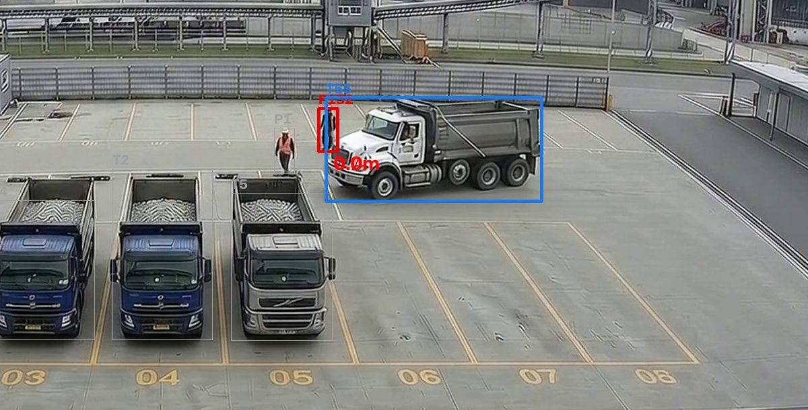
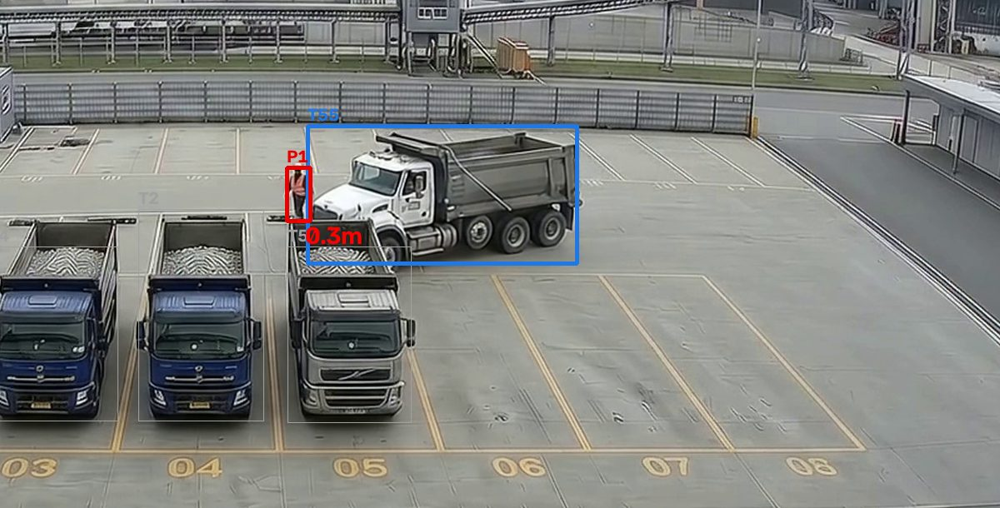
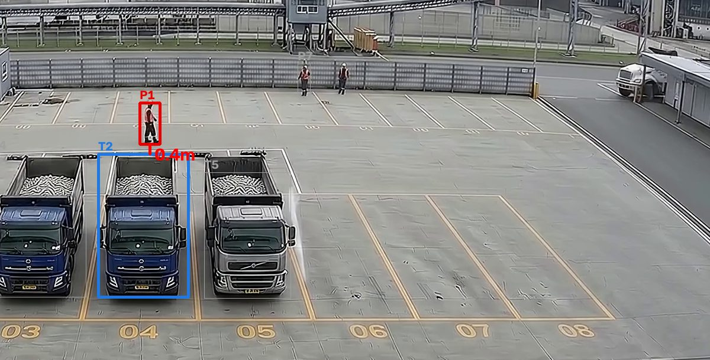

# 실제 영상으로 판정 규칙 다시 확인 (R9 · I6)

영상: `해커톤/영상/` 4개 (git 제외). 탐지: YOLO11n(COCO 사전학습) + ByteTrack, 모든 프레임(24fps) — `py vision/detect_video.py`.
확인 방법: 탐지 결과(det.json)의 트럭 박스 세로/가로 비율을 시간별로 뽑고, 같은 시각 프레임을 직접 보며 맞는지 비교.

## 1. 채널별 탐지 결과

| 채널 | 영상 | 보이는 장면 | 탐지 | 판정 |
|---|---|---|---|---|
| CAM-01 호퍼 A | 1호퍼 영상 (측면, 15초) | 덤프트럭 1대가 호퍼 옆에서 적재함을 올려 하차 → 내리고 떠남 | 트럭 잡힘(신뢰도 0.5~0.95) | ✅ 사용 |
| CAM-02 호퍼 B | 2호퍼 영상 (후면 실내, 15초) | 트럭이 뒤로 들어와 하차 | **트럭을 못 잡음**(oven·tv 등으로 오인, 신뢰도 0.05에서도 truck 없음) | ❌ 파인튜닝 필요 — 영상 재생만 |
| CAM-03 호퍼 C | 3호퍼 영상 (측면, 15초) | 덤프트럭 1대가 원료 더미 옆에 하차 | 트럭 잡힘. 오른쪽 원료 벽을 트럭으로 오인(계속 정지) | ✅ 구역에서 제외 |
| CAM-04 대기장 | 대기소 영상 (전경, 16.6초) | 주차 5대 + 1대 진입, 작업자 2~4명 | 트럭 6대 · 사람 잡힘. 추적 ID가 자주 바뀜(트럭 ID 28개) | ✅ ID 합치기 후 6대 |

## 2. 적재함 상승 비율 0.6 (측면 카메라)

| 채널 | 실제(프레임 확인) | 한 프레임 비율 그대로 | 바꾼 규칙(1초 중앙값 + 1초 유지) |
|---|---|---|---|
| CAM-01 | 내림 0~2초(0.57~0.59) · 상승 약 2.3~12초(0.64~1.01) · 내린 뒤 비스듬히 떠남 12.5~15초 | 2.0초 상승, 11.5초 내림 · **떠날 때 12.8초부터 다시 0.6~0.7로 상승 오판** | 3.7초 상승 · 12.9초 내림 · 14.4초 상승 오판 1건(클립 끝 0.6초) |
| CAM-03 | 내림 0~4초(0.48~0.49) · 상승 약 4.3~12.5초 · 내림 13초~ | 4.3~7.5초에 상승/내림이 **프레임마다 20번 넘게 뒤집힘**(올라가는 중 트럭이 운전석·적재함 두 박스로 쪼개짐) | 6.1초 상승 · 14.5초 내림 (한 번씩) |

- **0.6 기준 자체는 맞다**: 내림 0.48~0.59, 상승 0.64~1.01로 두 영상 모두 갈린다. 값은 바꾸지 않았다.
- **바꾼 것**: 한 프레임 값 대신 같은 추적 ID의 최근 1초 중앙값을 쓰고, 그 결과가 1초 유지돼야 상승/내림을 바꾼다(`vision/to_events.py` RAISED · RAISE_WIN, 화면 겹치기도 같은 규칙).
- **대가**: 실제보다 1.5~2초 늦게 바뀐다(하차 10분 기준이면 무시할 수준).
- **남은 한계**: 차가 비스듬히 빠져나갈 때(후면에 가까운 각도) 비율이 0.6을 넘는다. 이번 영상에선 클립 끝 0.6초만 남았다. "정차 중일 때만"도 시험했지만 박스 흔들림(프레임마다 10~40px)이 커서 상승 중에도 정차가 아니라고 나와 버렸다 → 쓰지 않음.
- 후면 카메라(CAM-02)는 이 규칙이 맞지 않는다(세로/가로가 상승과 무관). 후면은 적재함 상단 높이 변화 등 다른 규칙이 필요하다.

## 3. 3초 규칙 (구역 진입·이탈)

- CAM-01에서 적재함을 끝까지 올린 5.5~7.4초 동안 **YOLO가 트럭을 아예 놓친다(1.9초)**. 3초 규칙 덕분에 이탈·재진입으로 잘못 기록되지 않았다 → 3초 유지.
- 같은 구간 뒤 추적 ID가 1 → 5 → 6으로 바뀐다. **새 ID가 3초 안에 본 트럭 박스와 40% 넘게 겹치면 같은 트럭**으로 합친다(`SAME_IOU`). 대기장도 ID 28개 → 실제 6대.
- 큰 트럭 박스 안에 들어간 작은 박스(운전석만 잡힘)와 화면 0.3%보다 작은 박스는 버린다(`MIN_AREA`).
- 화면에서 1초 넘게 안 보이면 구역 밖 후보로 본다(그보다 짧은 끊김은 무시).

## 4. 영상 → 이벤트 결과 (영상 한 번 = 반입 한 번)

`py tools/ingest_videos.py` (영상 시각 ×40: 15초 → 10분, 계근 GATE_IN·원료는 가정으로 붙임)

| 채널 | 이벤트 |
|---|---|
| CAM-01 | BAY_ENTER(베이 1) +2분 → BAY_EXIT +10분(클립 끝에서 닫음) — 반입 1건 |
| CAM-02 | 없음(탐지 없음) |
| CAM-03 | BAY_ENTER(베이 1) +2분 → BAY_EXIT +10분 — 반입 1건 |
| CAM-04 | ZONE_ARRIVE 6대 |

서버 결과: ok 18 · ignored 12(정지·이탈처럼 상태를 바꾸지 않는 신호). 같은 영상을 다시 넣으면 30건 모두 duplicate.

## 5. 안전 경고

- 호퍼 영상 3개에 덤프 반경·후진 경로 안 사람 장면이 **없다**(CAM-03 2.2초에 사람 0.2초 잡힘, 반경 밖). → 영상으로는 안전 경고가 나오지 않는다.
- 대기장 영상의 작업자는 대기장이라 안전 규칙(하차 중 덤프 반경) 대상이 아니다.

## 6. 대기장 사람·트럭 접근 (R16, 규칙 ③)

호퍼 영상 3개에는 사람이 나오지 않아 R15 아차사고는 합성 사람으로 시연했다. R16에서 합성을 끄고(기본) **대기장 영상(CAM-04)에 실제로 찍힌 사람**으로 판정한다.

**영상에 나온 사람** (YOLO11n 사전학습 · ByteTrack, 16.5초 · 399프레임 중 369프레임에 사람)

| 사람(추적 ID) | 보인 구간 | 가장 가까운 트럭 | 결과 |
|---|---|---|---|
| #132 | 3.6~10.3초 | #55(움직임, 오른쪽에서 들어옴) | **L3 · 최소 0.0m(박스 겹침) · 3.4초** — 트럭 앞을 걷다가 트럭이 바로 앞까지 옴 |
| #1 | 0~14.5초 | #55(움직임) — 11.6초 | **L3 · 최소 0.3m · 4.0초** — 지나가는 트럭 바로 앞에 서 있음 |
| #1 | 0초 | #2(서 있음, 0.4m) | 제외: 처음 보인 순간 바로 옆 트럭 = 운전자 · 트럭도 서 있음 |
| #7 · #9 · #36 · #99 | 0~3.4초 | #5(서 있음, 3m 넘게) | 없음(서 있는 트럭 · 거리 밖). #7·#9·#36·#99는 같은 사람이 ID가 바뀐 것으로 보임 |
| #216 | 15.6~16.5초 | #2(서 있음) | 없음(서 있는 트럭) |

→ **실제 영상 아차사고 2건, 모두 L3**(움직이는 트럭 #55, 약 5~7km/h 가정 환산). 서 있는 트럭 옆 사람(운전자 승하차·서류 확인)은 한 건도 잡지 않았다.

장면(빨간 선 = 사람 발끝 ↔ 트럭 박스 가장 가까운 점, 거리 = 사람 키 1.7m 기준 환산):

**오탐·한계**
- 화면에서 사람 발끝과 트럭 박스가 겹치면 0m로 나온다. 실제로는 사람이 트럭 앞(카메라 쪽)이나 뒤에 있을 수 있다 — 위 두 장면은 눈으로 봐도 트럭 진행 방향 바로 앞이다.
- 사람 키(1.7m)로 거리를 환산하므로 사람이 앉거나 일부만 보이면 거리가 짧게(위험하게) 나온다. 박스 키 20px 미만이면 카메라 `m_per_px`(0.03)를 쓴다.
- 트럭 추적 ID가 바뀌면 1초 이동량을 다시 쌓는 동안(0.6초) 판정이 잠깐 비는데, 이번 영상에선 #55가 끝까지 같은 ID였다.
- 줄별 거리 보정(주차면 기준 길이)과 차량 통로만 위험 구역으로 다시 그리기는 다음 라운드(I4).

